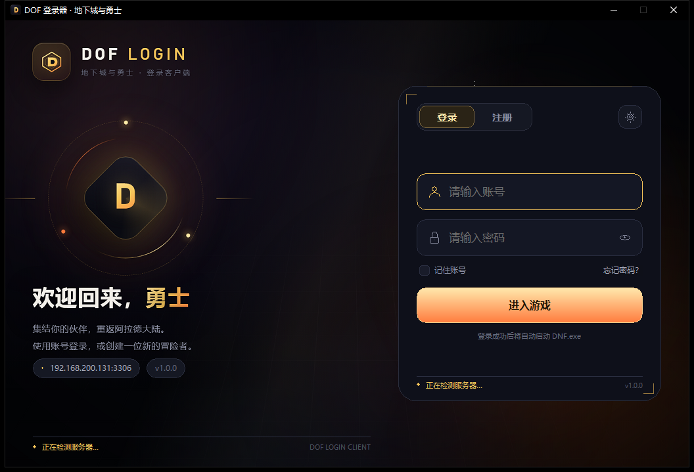
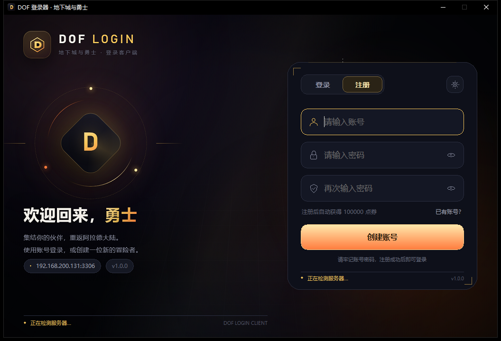
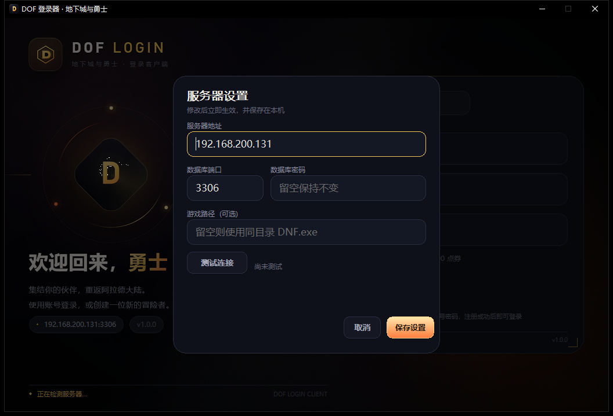

# DOF 登录器

地下城与勇士（DOF）登录客户端。现在有两个版本：

- **原生版（推荐，`client-native/`）**：纯 Win32 / GDI 原生界面，**真正的 0 依赖**，Windows 7 SP1 及以上直接运行。单文件约 **5.7 MB**，UPX 后约 **2.5 MB**。
- **WebView2 版（可选，`client/`）**：网页风格 UI。Win10/11 通常自带 WebView2；Win7/8 需要安装 WebView2 109。单文件约 6.1 MB。

## 下载

推荐直接下载 Release 中的 `DOF登录器.exe`（或体积更小的 `DOF登录器-UPX.exe`）。

GitHub 仓库只提交源码、文档和界面截图；`dist/`、`.toolchain/`、exe、日志等构建产物不会入库。



<table>
  <tr>
    <td></td>
    <td></td>
  </tr>
</table>

## 原生版特性

- **真正的 0 运行时依赖**：不需要 Node、Electron、.NET、WebView2、VC++ 运行库
- Windows 7 SP1 / 8 / 8.1 / 10 / 11 x64 可直接运行
- 深色金色游戏风格：登录 / 注册 / 设置 / 服务器状态 / 错误提示
- 内置 MySQL 登录 / 注册、RSA 登录凭证、自动启动 `DNF.exe`
- 记住账号、显示/隐藏密码、测试连接、服务器设置
- 单文件 exe，约 **5.7 MB**（UPX 后约 **2.5 MB**）
- 原生窗口 + 原生 EDIT 输入框，支持系统输入法和中文显示

### 体积对比

| 方案 | 体积 |
| --- | --- |
| 旧版 `pkg` + Node 18 | 约 45–80 MB |
| Electron | 150 MB 以上 |
| **原生版（Go + Win32）** | **约 5.7 MB** |
| 原生版 + UPX（可选） | 约 2.5 MB |
| WebView2 版 | 约 6.1 MB（Win7 另需 WebView2 109） |

> exe 只包含登录器本身，不包含游戏资源。把它放到 `DNF.exe` 所在目录即可。

## 运行要求（原生版）

- Windows 7 SP1 / 8 / 8.1 / 10 / 11，x64
- 无其他依赖，不需要安装任何运行库
- Windows 7 只需是 SP1 x64 即可（原生版不依赖 WebView2）

## 使用

1. 将 `DOF登录器.exe` 放到 `DNF.exe` 所在目录。
2. 双击打开，输入账号密码登录；没有账号可切到“注册”创建。
3. 登录成功后会自动启动同目录下的 `DNF.exe`。
4. 如果登录器不在游戏目录，点击右上角齿轮，在“游戏路径”里填写完整的 `DNF.exe` 路径。
5. 服务器地址默认为 `192.168.200.131:3306`，可在设置中修改。

### 配置与日志

| 内容 | 位置 |
| --- | --- |
| 服务器设置 / 记住的账号 | `%APPDATA%\DOFLogin\config.json` |
| 运行日志 | `%APPDATA%\DOFLogin\launcher.log` |

删除 `config.json` 可以恢复默认服务器配置和清除记住的账号。

> WebView2 版额外使用 `%APPDATA%\DOFLogin\WebView2\` 和 `%LOCALAPPDATA%\DOFLogin\WebView2Loader109-v1\`，原生版不需要这些。

## 构建原生版

```powershell
cd client-native
.\build.ps1

# 同时生成 UPX 压缩副本
.\build.ps1 -Upx
```

- 首次构建会自动下载 **Go 1.20.14**（最后一个支持 Windows 7 的 Go 版本，约 110 MB），缓存到 `.toolchain/`
- 输出：`dist\DOF登录器.exe`
- `-Upx` 额外输出：`dist\DOF登录器-UPX.exe`（未压缩的原文件保留）
- 如果本机已经有 Go 1.20.x，可以指定：

```powershell
.\build.ps1 -GoExe "C:\Go1.20\bin\go.exe"
```

> 不要用 Go 1.21 或更高版本构建 Win7 版：Go 1.21+ 生成的 exe 要求 Windows 10 及以上。

如果 PowerShell 禁止运行脚本：

```powershell
powershell -ExecutionPolicy Bypass -File .\build.ps1
```

### 修改图标

图标和 `rsrc.syso` 在 `client-native/` 和 `client/` 各有一份。重新生成后同步到原生版目录：

```powershell
client\icon\build-icon.ps1
Copy-Item client\icon.ico, client\rsrc.syso client-native\ -Force
```

（图标生成脚本需要 Microsoft Edge 和 Node.js，只在修改图标时需要。）

### 测试

```powershell
cd client-native
go test ./...
```

测试会把 Go 生成的 RSA 登录凭证与旧版 Node 实现的输出逐字节比对，并校验 MD5 算法。构建脚本会自动用 Go 1.20.14 运行测试。测试还会校验根目录的 `publickey.pem` 与代码中内嵌的私钥是否匹配。

## WebView2 版（可选）

如果目标机器是 Windows 10/11，且想要网页版的界面细节，可以使用 `client/`：

```powershell
cd client
.\build.ps1
```

输出：`dist\DOF登录器-WebView2.exe`（`-Upx` 额外生成 `dist\DOF登录器-WebView2-UPX.exe`）。

- Windows 10/11：通常已自带 WebView2
- Windows 7/8：需要安装 **WebView2 Runtime 109**（最后一个支持版本），以及 SP1 + KB4474419
- 不是严格 0 依赖；如果要 Win7 开箱即用，请用原生版

## 项目结构

```
publickey.pem        服务端校验登录凭证用的公钥（提交到仓库）
privatekey.pem       客户端生成登录凭证用的私钥（也内嵌在 token.go 中）

client-native/      原生版（推荐，Win7 零依赖）
  main.go           程序入口、Win32 窗口、消息循环
  ui.go             UI 状态、窗口/控件、布局
  paint.go          GDI 绘制：卡片、字段、按钮、弹窗、Toast
  actions.go        登录/注册/设置/状态/计时器/交互
  win32.go          Win32 API 绑定、字体/GDI 辅助
  app.go            应用生命周期、启动 DNF.exe
  db.go             MySQL 登录 / 注册
  token.go          RSA 凭证生成、MD5（内嵌私钥）
  keys_test.go      校验公钥文件与内嵌私钥是否匹配
  config.go         设置与记住账号
  assets/           原生版背景图 + 生成用 HTML
  icon.ico          应用图标
  rsrc.syso         图标 + DPI manifest 资源
  build.ps1         构建脚本（自动使用 Go 1.20.14）

client/             WebView2 版（可选）
  ...               原有的 Go + WebView2 实现
  build.ps1         输出 DOF登录器-WebView2.exe

docs/               界面截图
tools/              密钥生成 / 同步脚本
legacy-node/        旧版 Node.js 命令行客户端（仅保留参考）
dist/               构建输出（已加入 .gitignore）
.toolchain/         自动下载的 Go 1.20.14（已加入 .gitignore）
```

## 实现说明（原生版）

- 使用 **Go + Win32 / GDI**，CGO 关闭，不引入任何 GUI 框架或浏览器内核。
- 使用 **Go 1.20.14** 构建，PE 子系统版本为 6.1，生成的 exe 可在 Windows 7 SP1 及以上运行。
- 背景/品牌区是根据原网页设计生成的静态 PNG（内嵌在 exe 中）；卡片、输入框、按钮、弹窗、Toast 全部由 GDI 实时绘制。
- 输入框是原生 EDIT 控件，支持中文输入法、密码模式、光标、选择、Tab 切换。
- 窗口创建、WndProc 和消息循环通过 `runtime.LockOSThread` 固定在同一 OS 线程；所有 Win32 DLL/函数在窗口创建前预加载，避免回调中的加载器死锁。
- 高 DPI：优先 `GetDpiForWindow`，Windows 7 / 8 回退到 `GetDeviceCaps`，窗口和字体按比例缩放。
- MySQL / RSA 逻辑与旧版一致，登录凭证测试通过。

## 密钥说明（重要）

登录凭证使用 RSA。仓库根目录包含这对密钥：

| 文件 | 用途 |
| --- | --- |
| `publickey.pem` | 游戏服务端校验登录凭证用的公钥 |
| `privatekey.pem` | 客户端生成登录凭证用的私钥（同时也内嵌在 `client/token.go` 和 `client-native/token.go` 中） |

这两个文件必须成对使用。`go test ./...` 会自动校验代码中内嵌的私钥与根目录 `publickey.pem` 是否匹配；如果只替换了一边，测试会失败，避免客户端和服务端密钥对不上。

> `tools/` 下的脚本只需要 Node.js，运行登录器本身不需要 Node.js。

### 更换密钥（完整流程）

> 客户端只会在运行时使用内嵌的私钥；服务端只使用 `publickey.pem`。两边必须来自同一对密钥。

#### 1. 生成新密钥（会覆盖根目录的 key 文件）

```powershell
node tools\generate-keys.js
```

脚本会先把旧密钥备份到 `keys-backup-<时间戳>/`，然后生成：

- `privatekey.pem`：PKCS#1 格式（`BEGIN RSA PRIVATE KEY`）
- `publickey.pem`：SPKI 格式（`BEGIN PUBLIC KEY`）

也可以使用 OpenSSL（注意 `-traditional`，否则 OpenSSL 3 可能生成 PKCS#8）：

```bash
openssl genrsa -traditional -out privatekey.pem 2048
openssl rsa -in privatekey.pem -pubout -out publickey.pem
```

#### 2. 同步代码里内嵌的私钥

```powershell
node tools\sync-keys.js
```

脚本会更新：

- `client/token.go`
- `client-native/token.go`
- `legacy-node/main.js`（如果该文件存在）

只检查、不修改：

```powershell
node tools\sync-keys.js --check
```

正常输出：

```text
OK: client/token.go
OK: client-native/token.go
OK: legacy-node/main.js
all embedded private keys match privatekey.pem
```

#### 3. 更新服务端

把新的 `publickey.pem` 放到游戏服务端用于校验登录凭证的位置，然后重启服务端。

> 客户端不需要 `publickey.pem`；它使用的是代码里内嵌的私钥。服务端不需要私钥。

#### 4. 运行测试

```powershell
cd client-native
go test ./...

cd ..\client
go test ./...
```

测试会同时校验：

- 代码中内嵌的私钥是否等于 `privatekey.pem`
- `publickey.pem` 和私钥是否属于同一对密钥

#### 5. 重新构建两个客户端

```powershell
cd client-native
.\build.ps1 -Upx

cd ..\client
.\build.ps1 -Upx
```

输出：

```text
dist\DOF登录器.exe
dist\DOF登录器-UPX.exe
dist\DOF登录器-WebView2.exe
dist\DOF登录器-WebView2-UPX.exe
```

#### 6. 发布新版本

更换密钥后，**旧客户端无法再登录新服务端**。需要把所有客户端更新到新 exe，并在 GitHub Releases 上传新的构建产物。

> **密钥格式提醒**：私钥必须是 `BEGIN RSA PRIVATE KEY`（PKCS#1），公钥必须是 `BEGIN PUBLIC KEY`（SPKI）。如果格式不正确，`tools/sync-keys.js` 会直接报错。

> **开源说明**：客户端必须内置私钥才能生成登录凭证。本项目开源后，私钥就是公开的，任何拿到源码的人都可以生成登录凭证。这套机制只适合你信任的私服 / 局域网环境；如果要防止伪造，需要在服务端改为不依赖客户端内置私钥的认证方案。公开或正式服务器请更换密钥对，并同时更新服务端公钥和客户端内嵌私钥。

## 安全提醒

- 本项目是开源客户端，RSA 私钥和数据库密码都内置在代码 / 配置中，不能作为真正的秘密；请阅读上面的“密钥说明”。
- 这套登录凭证机制只适合私服 / 局域网环境；公开或正式服务器请更换密钥，并评估更安全的认证方案。
- `config.json` 中的数据库密码是明文保存的，仅适合在个人电脑 / 局域网内使用。
- 如果服务端密码或密钥已经泄露，建议更换并重新构建客户端。
- Windows 7 已停止安全更新；原生版保留兼容性，但建议尽量升级操作系统。

## 常见问题

**Windows 7 打不开 / 提示缺少 DLL**

原生版不需要任何运行库，请确认是 **Windows 7 SP1 x64**，并检查杀毒软件是否拦截。WebView2 版才需要 WebView2 Runtime 109。

**提示“未找到 DNF.exe”**

把登录器放到 `DNF.exe` 同目录，或在设置里填写完整游戏路径。

**提示“连接服务器超时” / “无法连接服务器”**

检查服务器 IP、端口、MySQL 是否启动、服务端防火墙是否放行 3306，以及数据库密码是否正确。

**界面打不开 / 提示缺少 WebView2（仅 WebView2 版）**

Windows 10 / 11：安装 [Microsoft Edge WebView2 运行库](https://developer.microsoft.com/microsoft-edge/webview2/)。
Windows 7 / 8：安装 WebView2 Runtime 109，并确认系统已安装 SP1 和 KB4474419（SHA-2 更新）。

**注册提示“该账号已存在”**

账号名已被占用，换一个名称即可。

**Windows 提示“已保护你的电脑” / SmartScreen**

这是未签名 exe 的常见提示，点击“更多信息 → 仍要运行”。如果杀毒软件误报，优先使用未压缩的 `DOF登录器.exe`。

**旧版 Node 版本在哪？**

完整保留在 `legacy-node/` 目录，仅用于对照，新的构建流程不再使用 Node。

## 发布说明（GitHub）

- 仓库只提交源码、文档和界面截图，不提交 `dist/`、`.toolchain/`、`*.exe`、`*.log`、`*.rar`
- 发布 Release 时上传 `dist\DOF登录器.exe` 和 `dist\DOF登录器-UPX.exe`
- 未签名的 exe 首次运行可能触发 Windows SmartScreen，点击“更多信息 → 仍要运行”
- UPX 压缩版可能被杀毒软件误报；优先分发未压缩的 `DOF登录器.exe`
